# Commit Blaster

Your GitHub contribution graph, invaded. Every day you committed becomes an alien, and a little ship shoots them down one by one, then the wave respawns.

<picture>
  <source media="(prefers-color-scheme: dark)" srcset="examples/commit-blaster-dark.svg">
  
</picture>

Zero dependencies, one SVG, regenerated daily by a GitHub Action. Busier days become tougher-looking aliens.

## Add it to your profile in 2 minutes

1. Open your profile repository (the repo named exactly after your username).
2. Create `.github/workflows/commit-blaster.yml` with this:

```yaml
name: commit-blaster

on:
  schedule:
    - cron: '0 0 * * *'
  workflow_dispatch:

permissions:
  contents: write

jobs:
  generate:
    runs-on: ubuntu-latest
    steps:
      - uses: username/commit-blaster@v1
        with:
          username: ${{ username }}

      - name: Publish SVGs to the output branch
        run: |
          cd dist
          git init -q
          git checkout -q -b output
          git add .
          git -c user.name="github-actions[bot]" \
              -c user.email="41898282+github-actions[bot]@users.noreply.github.com" \
              commit -q -m "Update commit-blaster animation"
          git push -q --force \
            "https://x-access-token:${{ secrets.GITHUB_TOKEN }}@github.com/${{ github.repository }}.git" output
```

3. Go to the **Actions** tab, pick **commit-blaster**, and click **Run workflow**.
4. Paste this into your profile `README.md`, replacing `YOUR_NAME` with your username:

```html
<picture>
  <source media="(prefers-color-scheme: dark)" srcset="https://raw.githubusercontent.com/YOUR_NAME/YOUR_NAME/output/commit-blaster-dark.svg">
  
</picture>
```

It updates itself every night from then on.

## Options

| Input          | Default               | What it does                                      |
| -------------- | --------------------- | ------------------------------------------------- |
| `username`     | (required)            | Whose contributions become targets                |
| `github_token` | `${{ github.token }}` | Reads the contribution calendar                   |
| `output_dir`   | `dist`                | Where the two SVGs (light and dark) are written   |
| `style`        | `aliens`              | `aliens` for pixel sprites, `squares` for classic cells |
| `speed`        | `1`                   | Animation speed, from `0.25` to `4`               |

## Run it locally

```bash
git clone https://github.com/YOUR_USERNAME/commit-blaster
cd commit-blaster

# Preview with sample data, no token needed
node cli.js --demo --out preview

# Your real graph
GITHUB_TOKEN=ghp_yourtoken node cli.js --user your-name --out preview
```

Requires Node 18 or newer. There is nothing to install.

## How it works

The action reads your last year of contributions through the GitHub GraphQL API, then plans a timeline: the ship sweeps left to right, stops under each column, and fires at the lowest alien first. Each bullet and each alien gets its own CSS keyframes inside the SVG, so the animation runs anywhere an image does, including GitHub READMEs, with no JavaScript. Viewers who prefer reduced motion see a still frame.

## Contributing

Ideas that would make great first PRs: new alien sprite packs, a score counter, more color themes, shields, or a boss for your best day of the year. Open an issue to discuss bigger changes, and run `npm test` before sending a PR.

## License

MIT
